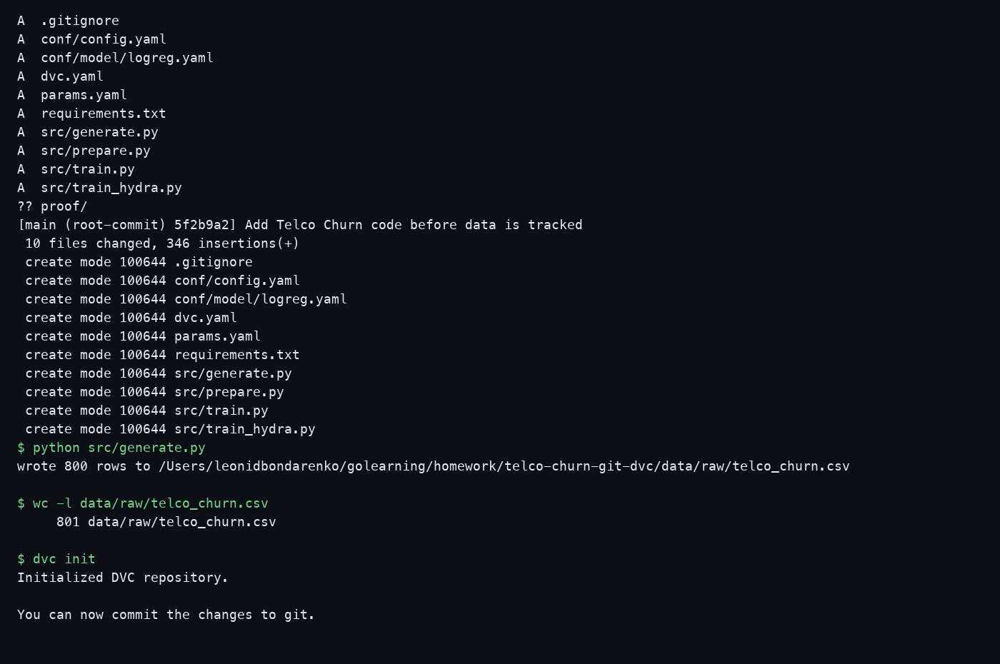
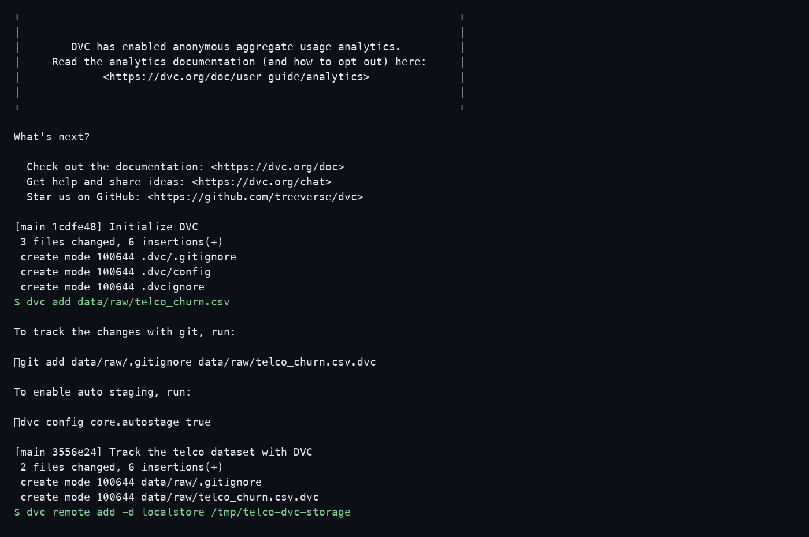
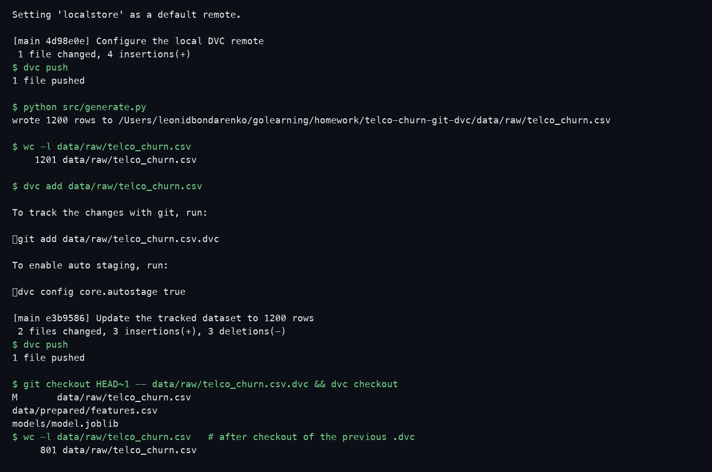
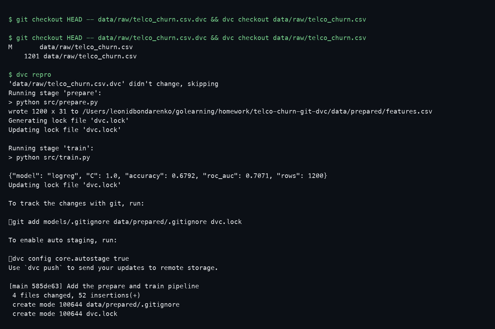
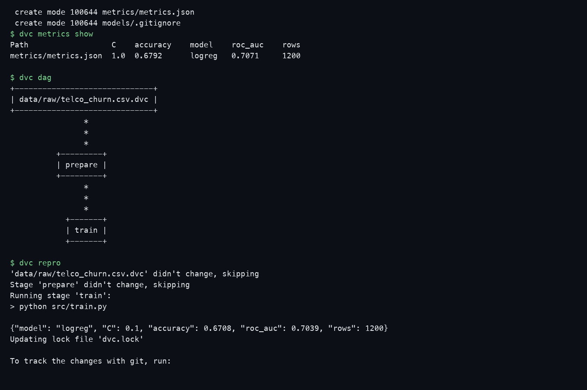
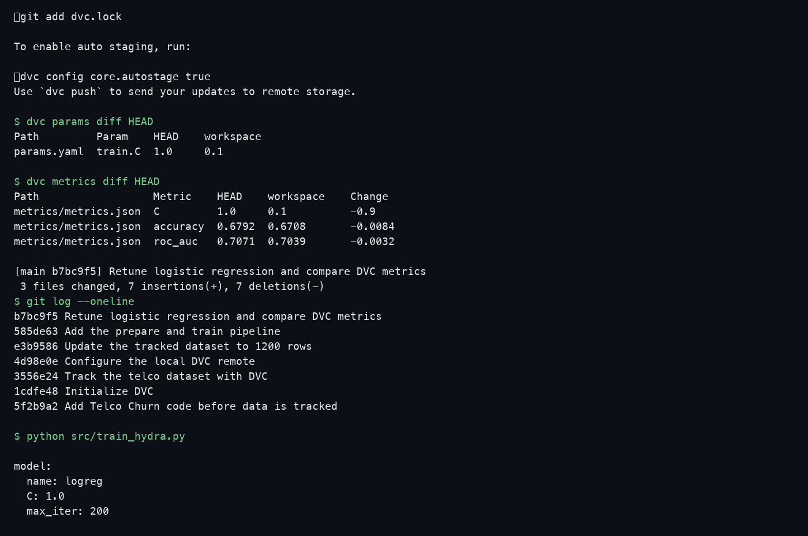
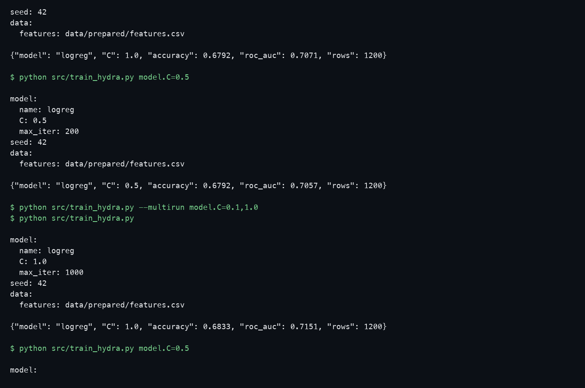
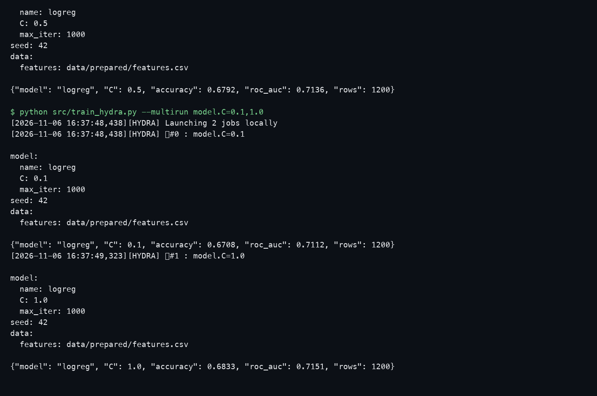

# Telco Churn: Git, DVC, Hydra

The dataset generator follows the deployed [telco-churn-synthetic](https://github.com/Leonid328/telco-churn-synthetic) project. This repository repeats the case-study workflow for Git and DVC, then runs the same trainer through Hydra.

Large files stay out of Git. Git stores `.dvc` pointers, `dvc.yaml`, `dvc.lock`, and `metrics/metrics.json`. The CSV and the model live in the DVC cache and were pushed to a local remote (`/tmp/telco-dvc-storage`).

## Case study

```bash
python -m venv .venv && . .venv/bin/activate
pip install -r requirements.txt

git init -b main
git add .gitignore requirements.txt params.yaml conf src dvc.yaml
git commit -m "Add Telco Churn code before data is tracked"

python src/generate.py          # params.yaml -> 800 rows
dvc init
git add .dvc .gitignore
git commit -m "Initialize DVC"

dvc add data/raw/telco_churn.csv
git add data/raw/telco_churn.csv.dvc data/raw/.gitignore
git commit -m "Track the telco dataset with DVC"

mkdir -p /tmp/telco-dvc-storage
dvc remote add -d localstore /tmp/telco-dvc-storage
git add .dvc/config
git commit -m "Configure the local DVC remote"
dvc push

# second version of the same file
# params.yaml generate.samples: 800 -> 1200
python src/generate.py
dvc add data/raw/telco_churn.csv
git add params.yaml data/raw/telco_churn.csv.dvc
git commit -m "Update the tracked dataset to 1200 rows"
dvc push

# restore the previous dataset, then come back
git checkout HEAD~1 -- data/raw/telco_churn.csv.dvc
dvc checkout data/raw/telco_churn.csv    # 801 lines
git checkout HEAD -- data/raw/telco_churn.csv.dvc
dvc checkout data/raw/telco_churn.csv    # 1201 lines

dvc repro
dvc metrics show
dvc dag

# params.yaml train.C: 1.0 -> 0.1
dvc repro
dvc params diff HEAD
dvc metrics diff HEAD
```

`dvc metrics diff` after `C: 1.0` to `C: 0.1`:

| metric | before | after |
| --- | --- | --- |
| accuracy | 0.6792 | 0.6708 |
| roc_auc | 0.7071 | 0.7039 |

## Hydra

```bash
python src/train_hydra.py
python src/train_hydra.py model.C=0.5
python src/train_hydra.py --multirun model.C=0.1,1.0
```

The sweep prints one JSON line per job. Default `model.C=1.0` on 1200 rows: accuracy 0.6833, ROC-AUC 0.7151.

## Screenshots









